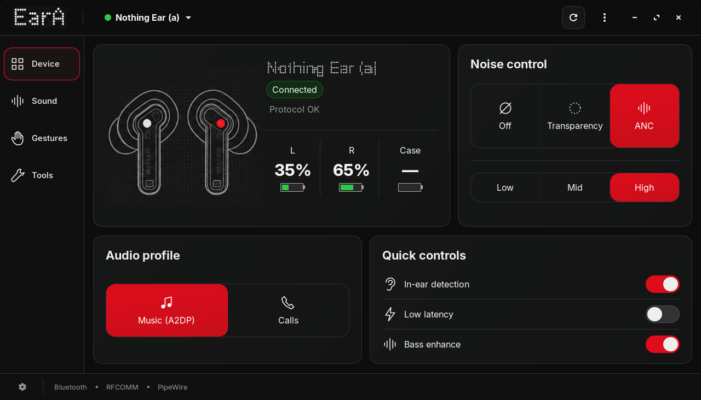
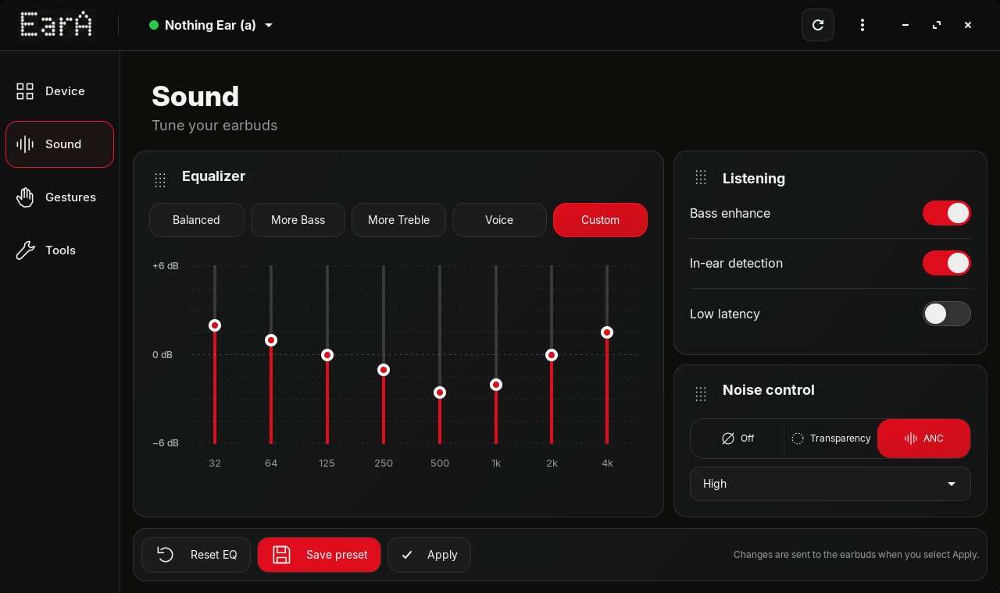

<div align="center">


**Unofficial GTK4 companion for Nothing and CMF earbuds on Linux**

[](https://github.com/oneydef/EarA-linux/actions/workflows/ci.yml)
[](LICENSE)

[Website](https://oneydef.github.io/EarA-linux/) · [Downloads](https://github.com/oneydef/EarA-linux/releases/latest) · [Supported devices](LINEUP.md) · [Roadmap](ROADMAP.md) · [Contribute](CONTRIBUTING.md)

</div>

EarA brings battery status, noise control, EQ, gestures, Find My Earbuds, and Bluetooth audio controls to the Linux desktop through a native GTK4 interface and a scriptable command-line client.

<p align="center">
  
</p>
<p align="center"><sub><strong>Device</strong> — connection, battery, audio profiles, noise control, and quick settings</sub></p>

<p align="center">
  
</p>
<p align="center"><sub><strong>Sound</strong> — equalizer, listening controls, and synchronized settings</sub></p>

## Highlights

- Redesigned fixed 1200×720 interface with consistent typography, spacing, icons, and navigation
- Light connection and recovery screens with dark Device, Sound, Gestures, and Tools workspaces
- More reliable discovery, reconnection, service diagnostics, and state restoration
- Corrected equalizer presets and synchronized quick controls across Device and Sound

## Features

- Battery levels for the left earbud, right earbud, and case
- ANC, transparency, listening modes, bass, and equalizer controls
- Gesture remapping, in-ear detection, ear-tip fit test, and Find My Earbuds
- A2DP music playback with optional headset-microphone mode
- GTK4/libadwaita desktop app and a scriptable CLI

## Install

Download the latest **AppImage**, **DEB**, **RPM**, or standalone **Flatpak** bundle from [GitHub Releases](https://github.com/oneydef/EarA-linux/releases/latest).

### Debian / Ubuntu

```bash
sudo dpkg -i eara_*_all.deb
eara gui
```

### Flatpak bundle

```bash
flatpak install --user ./EarA-*.flatpak
flatpak run io.github.oneydef.eara
```

<details>
<summary>Install from source</summary>

```bash
sudo apt install python3 python3-gi python3-gi-cairo python3-cairo python3-dbus gir1.2-gtk-4.0 gir1.2-adw-1 bluez
git clone https://github.com/oneydef/EarA-linux.git
cd EarA-linux
./scripts/install-user.sh
eara gui
```

This installs `eara` to `~/.local/bin` and adds EarA to the application menu.

</details>

## Desktop panel indicator

Native installations can run `eara indicator` (or launch **EarA Indicator** from
the application menu) to show battery levels and the current noise-control mode
without keeping the main window open. On Ubuntu, install the optional menu binding:

```bash
sudo apt install gir1.2-dbusmenu-glib-0.4
eara indicator
```

The panel icon shows two earbuds with separate left/right battery gauges and a
listening-mode symbol: a green shield for ANC, yellow sound waves for transparency,
and a red hollow circle when noise control is off. Each battery gauge smoothly
changes from green (80% and above) through yellow (50%) to red (20% and below);
unavailable readings use dashed gauges. The panel has no text labels. Click for
exact battery percentages, noise-control modes,
**Open EarA**, and **Quit indicator**. On Ubuntu GNOME, double-clicking opens the
full window directly; other StatusNotifier hosts choose their activation gesture.
GNOME needs AppIndicator support, which Ubuntu enables by default. Ubuntu preserves
the wide SVG icon; other StatusNotifier hosts may fit it into a square slot.
The icon updates only when its appearance changes and uses no animation.

Readings refresh every 10 seconds. The indicator hides when no earbuds are
connected and reappears after connection. Monitoring does not reconnect earbuds, switch
audio profiles, or power off Bluetooth when the indicator exits. Unavailable
readings in the menu show `—`; a cached case reading has `~`, and charging has `+`. The
indicator continues running after the EarA window closes.

Autostart is opt-in. For a DEB/RPM install:

```bash
mkdir -p ~/.config/autostart
cp /usr/share/applications/eara-indicator.desktop ~/.config/autostart/
```

For a user installation, copy `~/.local/share/applications/eara-indicator.desktop`
instead. Remove that autostart file to disable startup. Flatpak/AppImage indicator
packaging is not included yet; the existing GUI and CLI remain available there.

## Device support

**Nothing Ear (a)** is validated end to end. **CMF Buds 2** has tested battery reporting, listening modes, EQ, and Bluetooth audio support.

EarA also includes profiles for other Nothing and CMF models that use the same RFCOMM protocol family. Their individual controls still need community testing. See the [device matrix](LINEUP.md) for the current status.

## Command line

```bash
eara status
eara connect
eara anc transparency
eara eq more_bass
eara graphic-eq 0 0 0 0 0 0 0 0
eara audio mic
eara audio hfp
eara ring both
eara doctor
```

If Linux cannot claim the A2DP connection, disconnect the earbuds from the phone first.

## Project

- [Device support matrix](LINEUP.md)
- [Roadmap](ROADMAP.md)
- [Contributing guide](CONTRIBUTING.md)
- [Project website](https://oneydef.github.io/EarA-linux/)

Linux is the primary platform. Native macOS and Windows support is planned after the shared protocol and platform-independent core are ready.

## Featured

- [OMG! Ubuntu — *This App Lets You Manage Nothing & CMF Earbuds on Linux*](https://www.omgubuntu.co.uk/2026/10/cmf-nothing-earbuds-linux-companion-app)
- [FOSSWire — *EarA Open-Source GTK4 App Manages Nothing and CMF Earbuds on Linux*](https://fosswire.org/news/eara-open-source-gtk4-app-manages-nothing-and-cmf-earbuds-on)
- [Root.cz — *Softwarová sklizeň: EarA for Nothing and CMF earbuds*](https://www.root.cz/clanky/softwarova-sklizen-4-11-2026-postovni-server-s-kalendari-a-kontakty/)
- [Mamá Libre — *EarA: la app open source para manejar auriculares Nothing y CMF desde Linux*](https://mamalibre.com.ar/blog/eara-la-app-open-source-para-manejar-auriculares-nothing-y-cmf-desde-linux)
- [LinuxFokus — *Mit dieser App können Sie Nothing- und CMF-Ohrhörer unter Linux verwalten*](https://linuxfokus.de/mit-dieser-app-koennen-sie-nothing-und-cmf-ohrhoerer-unter-linux-verwalten/)
- [Hacks.gr — *Νέο πρόγραμμα φέρνει τον πλήρη έλεγχο των ακουστικών Nothing και CMF στο Linux*](https://hacks.gr/neo-programma-fernei-ton-pliri-elegcho-ton-akoystikon-nothing-kai-cmf-sto-linux/)

## Support

EarA is free and open-source. If it is useful to you, you can [buy the developer a coffee](https://buymeacoffee.com/r18fon7sj9).

## License

[GPL-3.0-or-later](LICENSE) · Copyright © 2026 [oneydef](https://github.com/oneydef)

Product names are trademarks of their owners; see [TRADEMARKS.md](TRADEMARKS.md) and [NOTICE](NOTICE).

<details>
<summary>Protocol reference</summary>

RFCOMM channel discovered through SDP (usually 15; newer CMF models may use 16) · UUID `aeac4a03-dff5-498f-843a-34487cf133eb` · frames `55 60 01 | cmd | dir | len | seq | payload | CRC-16/ARC`.

</details>
