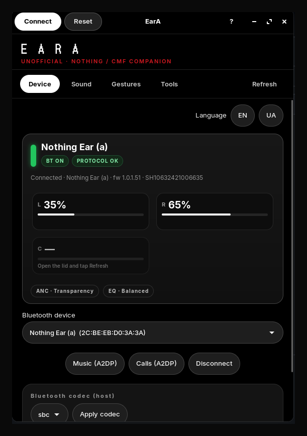
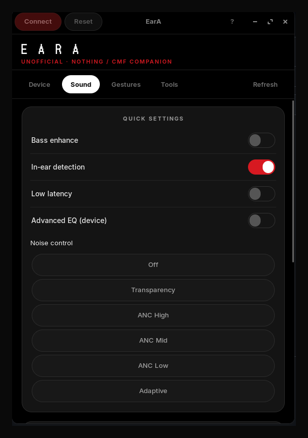

<div align="center">


**Unofficial GTK4 companion for Nothing and CMF earbuds on Linux**

[](https://github.com/oneydef/EarA-linux/releases/latest)
[](https://oneydef.github.io/EarA-linux/)
[](LICENSE)

[Supported devices](LINEUP.md) · [Roadmap](ROADMAP.md) · [Contribute](CONTRIBUTING.md)

</div>

<div align="center">

[](https://oneydef.github.io/EarA-linux/#release)

**[Open the live release countdown →](https://oneydef.github.io/EarA-linux/#release)**<br>
The date is the current preview target, not a guarantee of a production release.

</div>

EarA brings battery status, noise control, EQ, gestures, find-my, and Bluetooth audio controls to the Linux desktop. It includes a native GTK4 interface and a command-line client.

<p align="center">
  
  &nbsp;
  
</p>

## Highlights

- Battery levels for the left earbud, right earbud, and case
- ANC, transparency, listening modes, bass, and EQ controls
- Gesture remapping, in-ear detection, ear-tip fit test, and Find My Earbuds
- A2DP music playback with optional headset-microphone mode
- GTK4/libadwaita desktop app plus a scriptable CLI

## Install

Download the latest **AppImage**, **DEB**, **RPM**, or standalone **Flatpak** bundle from [GitHub Releases](https://github.com/oneydef/EarA-linux/releases/latest).

### Debian / Ubuntu

```bash
sudo dpkg -i eara_*_all.deb
eara gui
```

### Flatpak bundle

```bash
flatpak install --user ./EarA-*.flatpak
flatpak run io.github.oneydef.eara
```

<details>
<summary>Install from source</summary>

```bash
sudo apt install python3 python3-gi python3-dbus gir1.2-gtk-4.0 gir1.2-adw-1 bluez
git clone https://github.com/oneydef/EarA-linux.git
cd EarA-linux
./scripts/install-user.sh
eara gui
```

This installs `eara` to `~/.local/bin` and adds EarA to the application menu.

</details>

## Device support

**Nothing Ear (a)** is validated end to end. **CMF Buds 2** has tested battery reporting, listening modes, EQ, and Bluetooth audio support.

EarA also includes profiles for other Nothing and CMF models that use the same RFCOMM protocol family. Their individual controls still need community testing. See the [device matrix](LINEUP.md) for the current status.

## Command line

```bash
eara status
eara connect
eara anc transparency
eara eq more_bass
eara graphic-eq 0 0 0 0 0 0 0 0
eara audio mic
eara audio hfp
eara ring both
eara doctor
```

If Linux cannot claim the A2DP connection, disconnect the earbuds from the phone first.

## Project

- [Device support matrix](LINEUP.md)
- [Roadmap](ROADMAP.md)
- [Contributing guide](CONTRIBUTING.md)
- [Interactive demo](https://oneydef.github.io/EarA-linux/)

Linux is the primary platform. Native macOS and Windows support is planned after the shared protocol and platform-independent core are ready.

## Featured

[OMG! Ubuntu — *This App Lets You Manage Nothing & CMF Earbuds on Linux*](https://www.omgubuntu.co.uk/2026/10/cmf-nothing-earbuds-linux-companion-app)

## Support

EarA is free and open-source. If it is useful to you, you can [buy the developer a coffee](https://buymeacoffee.com/r18fon7sj9).

## License

[GPL-3.0-or-later](LICENSE) · Copyright © 2026 [oneydef](https://github.com/oneydef)

Product names are trademarks of their owners; see [TRADEMARKS.md](TRADEMARKS.md) and [NOTICE](NOTICE).

<details>
<summary>Protocol reference</summary>

RFCOMM channel discovered through SDP (usually 15; newer CMF models may use 16) · UUID `aeac4a03-dff5-498f-843a-34487cf133eb` · frames `55 60 01 | cmd | dir | len | seq | payload | CRC-16/ARC`.

</details>
