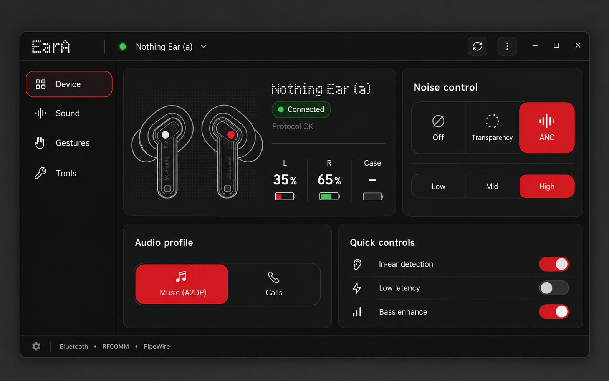
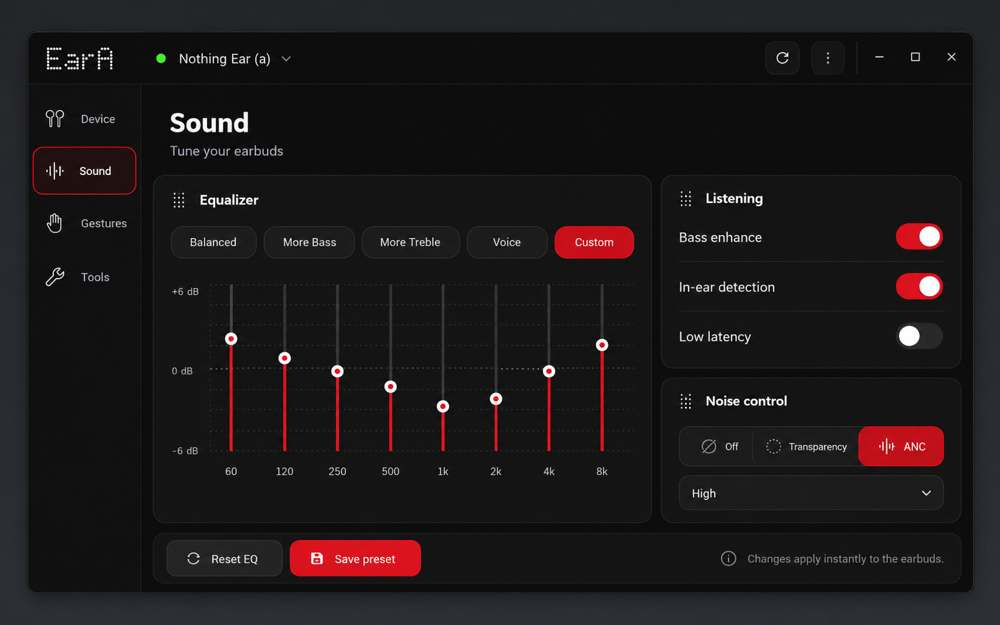
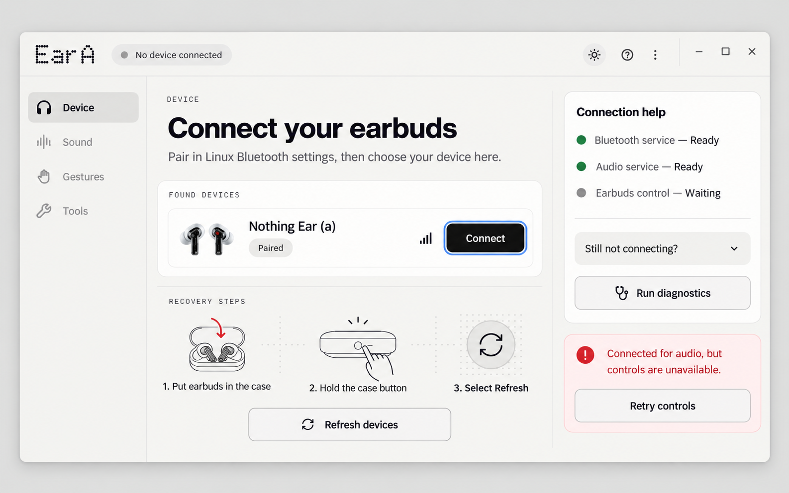

# EarA UI refresh concepts

These mockups explore the UI/UX refresh described in the project roadmap. They
are direction-setting concepts rather than pixel-perfect GTK specifications.

## Design direction

- Keep battery, connection, and ANC state visible at a glance.
- Use a compact desktop navigation rail instead of stacking every control on a
  single long page.
- Reserve Nothing-style dot typography for branding and small technical labels;
  use a highly readable sans-serif for controls and status text.
- Use red for selection and important actions, green only for healthy connection
  state, and neutral colors for everything else.
- Keep advanced features available without letting them crowd the common paths.
- Respect the desktop light/dark preference and preserve strong contrast, focus
  rings, large targets, and keyboard navigation.

## Concepts

### Device dashboard

The default connected view prioritizes per-bud battery, connection health, ANC,
audio profile, and the three most useful quick controls. It removes the separate
top-level Connect/Reset actions from the always-visible header and keeps recovery
actions contextual.

### Sound and equalizer

The Sound view combines presets, the eight-band equalizer, listening switches,
and noise control without turning the page into a long stack of full-width
buttons. Values remain visible and keyboard-addressable.

### Connection and recovery

The disconnected view uses plain-language instructions, separates Linux audio
health from the earbud control channel, and gives users a visible recovery path.
It also demonstrates a system-light variant instead of forcing a dark theme.

## Evidence considered

- EarA's public descriptions consistently emphasize battery, ANC, EQ, gestures,
  Bluetooth audio routing, and native Linux integration as the core value.
- Community feedback asks for a one-click Flatpak/Flathub installation and wider
  hardware support.
- Linux user reports frequently distinguish “paired over Bluetooth” from “usable
  as an audio device”, so those states should not be collapsed into one status.
- Community reactions to Nothing/CMF redesigns warn against cramped battery
  information and putting every control on one screen.
- AppImage catalog testing specifically noted that EarA should follow the system
  theme rather than defaulting to dark mode.

## Suggested implementation order

1. Introduce semantic connection states and the recovery panel.
2. Extract shared card, segmented-control, status-badge, and navigation styles.
3. Rebuild the Device page around the at-a-glance dashboard.
4. Rebuild Sound around presets plus the eight-band editor.
5. Add system light/dark support, then verify keyboard and screen-reader flows.

The PNGs were generated with the built-in image generation workflow using the
current EarA screenshots and public feedback as design inputs.
